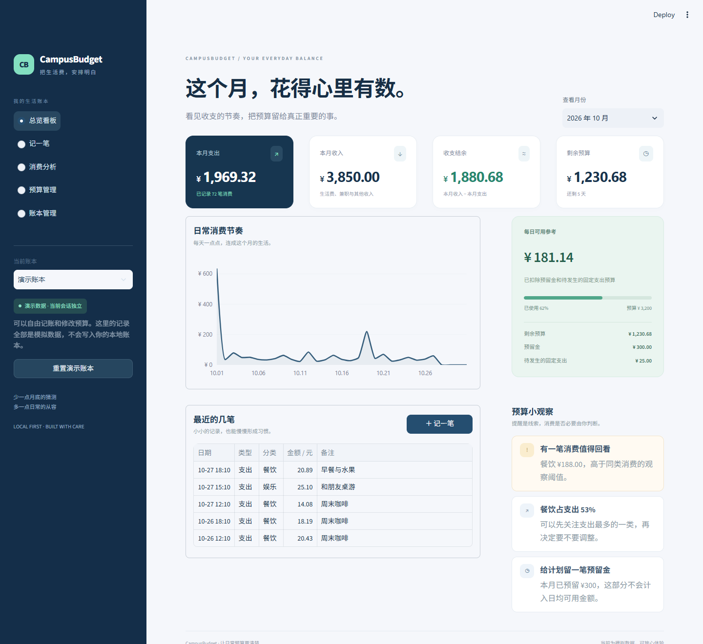
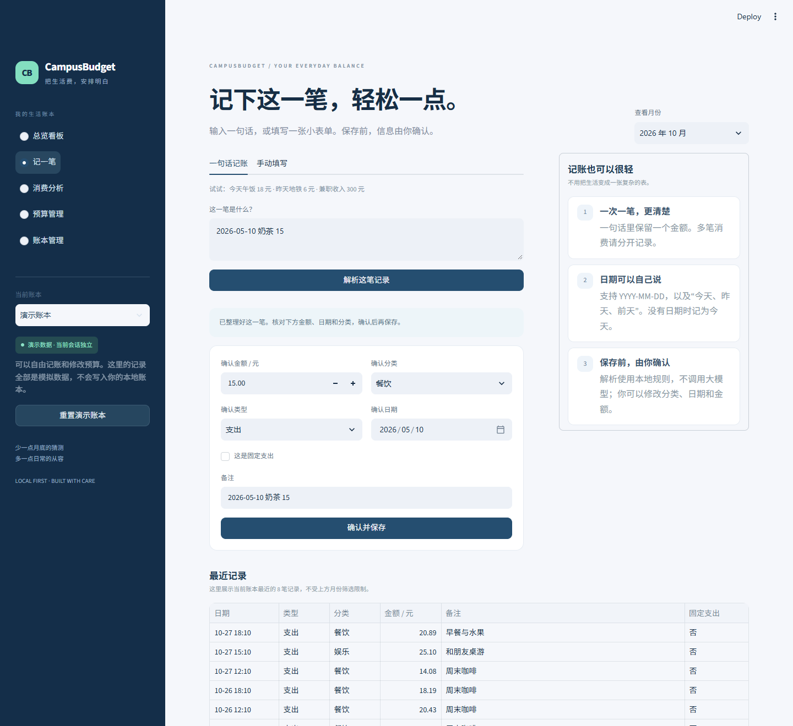
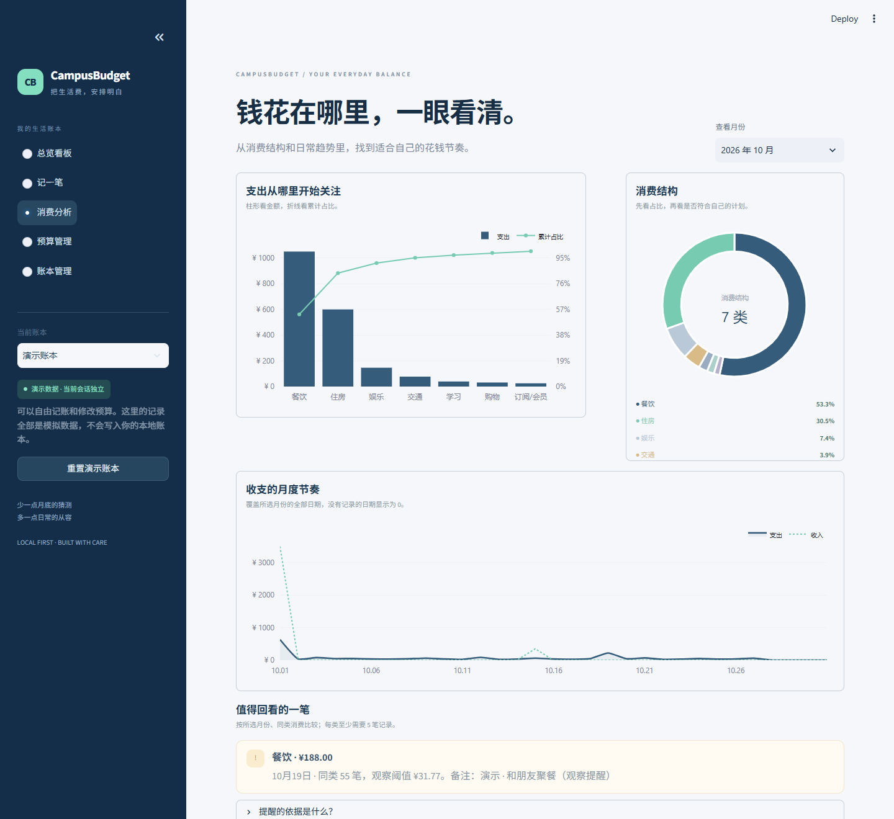

# CampusBudget

**把生活费，安排明白。** 一个面向大学生的个人预算管理 Web 原型，使用 Python、Streamlit、SQLite 和 Plotly 构建。

默认进入独立的演示账本，不用注册、不用配置 API Key，即可体验记账、预算与消费分析。本项目使用 AI 工具辅助开发；运行时的文本解析、计算和提醒均由本地规则完成，尚未接入大语言模型。



## 可以做什么

| 页面 | 功能 |
| --- | --- |
| 总览看板 | 查看月度收支、结余、预算余量、消费趋势和最近记录 |
| 记一笔 | 输入一句话或手动填写；先核对金额、分类、日期，再确认保存 |
| 消费分析 | 查看分类占比、Pareto 累计占比、完整月份收支趋势与可解释的异常提醒 |
| 预算管理 | 安排总预算、固定支出和预留金，计算每日可用金额 |
| 账本管理 | 按月份和类型查看明细、导出 CSV、确认后删除单笔记录 |

**两种账本相互独立：**

- **演示账本**：使用程序生成的模拟数据，每个浏览器会话使用独立的内存数据库。可以重置，不会改动本地账本。
- **本地账本**：首次使用为空，记录保存到本机 `data/budget.db`。该目录不会提交到 GitHub。

## 本地运行

需要 Python 3.10 或以上版本，推荐 3.12。以下命令在仓库根目录执行。

```bash
python -m venv .venv
```

Windows PowerShell：

```powershell
.\.venv\Scripts\python.exe -m pip install -r requirements.txt
.\.venv\Scripts\python.exe -m streamlit run app.py
```

macOS / Linux：

```bash
.venv/bin/python -m pip install -r requirements.txt
.venv/bin/python -m streamlit run app.py
```

启动后打开终端显示的 localhost 地址。也可以在 Windows 使用 `run.ps1`，它会检查并创建项目环境、安装依赖，然后启动应用。

## 交互示例

```text
今天午饭 18 元
昨天地铁 6 元
2026-05-10 奶茶 15
兼职收入 300 元
```

一次输入一笔、一个金额。日期先从文本中分离，避免把 `2026` 误识别为金额。多金额、负数和无效日期会提示修改，解析结果不会自动保存。



## 预算和提醒的计算依据

- 金额以**整数分**存入 SQLite；小数输入按分四舍五入。
- 日均可用参考 = `max(剩余预算 − 预留金 − 尚未发生的固定支出预算, 0) / 剩余天数`。剩余天数包含今天。
- 历史月份不再计算“每日可用”；未来月份按所选月份的完整天数计算。
- 异常消费按所选月份、同一分类比较。分类样本至少 5 笔，阈值为 `中位数 + 5 × MAD`；MAD 为 0 时使用保底阈值。金额至少 30 元且超过阈值才提示。
- 异常提示仅表示“值得回看”，不判断消费是否必要，也不能判断欺诈或重复扣费。



## 验证

```bash
python -m pip install -r requirements-dev.txt
python -m pytest -q
```

覆盖文本日期与金额解析、无效输入、金额精度、月份边界、预算约束、历史/未来月份、异常提醒、小样本处理、数据持久化、批量写入的原子性、演示/本地隔离以及五个页面的 Streamlit AppTest。

浏览器检查脚本位于 `scripts/browser_check.cjs`，需另行安装 Playwright。该脚本生成桌面和手机尺寸截图，检查导航、解析确认界面、浏览器错误和横向溢出。`docs/images/` 中的截图均由模拟数据生成。

GitHub Actions 在提交或拉取请求时运行测试。测试结果对应有限的预设场景，不代表所有自然语言输入都能正确解析。

## 目录

```text
app.py                    # 页面入口、账本切换与会话状态
campusbudget/
  core.py                 # 文本解析、预算计算、消费分析
  storage.py              # SQLite 数据校验与读写
  demo.py                 # 可复现的模拟账本
  ui.py                   # 视觉组件与图表样式
  views.py                # 五个功能页面
assets/style.css          # 深蓝与薄荷绿视觉样式、移动布局
.streamlit/config.toml    # Streamlit 主题与运行配置
tests/                    # 逻辑、存储、页面测试
docs/                     # 产品说明、技术设计与迭代记录
scripts/browser_check.cjs # 可选的浏览器验收脚本
```

## 项目说明

这是原有 CampusBudget 个人预算助手的界面与工程整理版，保留原来的记账、预算、分类统计和中位数/MAD 提醒思路。2026-10-27 的迭代增加了统一视觉、独立演示模式、解析确认步骤和回归测试，并修复日期识别和跨月计算问题。

当前适合作为个人项目作品展示和本地单人使用，未进行真实用户规模、留存或商业转化验证。没有用户登录、银行账单连接、云端多用户隔离或 LLM 运行时能力。作者的原始本地数据库、私密账单和账户信息不包含在本仓库中。

如果以后部署到公开服务器，应设置环境变量 `CAMPUSBUDGET_PUBLIC_DEMO=1`，只开放会话独立的演示账本，不开放共享的本地账本。仅把代码上传 GitHub，并不会自动获得在线应用地址。

- [产品与交互说明](docs/product.md)
- [架构与边界](docs/architecture.md)
- [迭代记录](docs/CHANGELOG.md)
- [AI 协作说明](docs/ai-collaboration.md)
